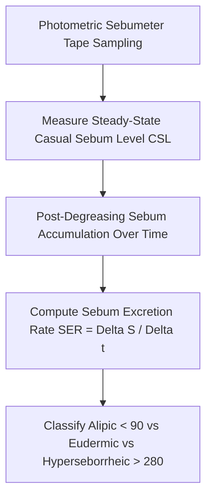

# Cutaneous Sebaceous Lipogenesis Sebumetry Personal Agent Skill

[](LICENSE)
[](https://www.python.org/)
[]()
[]()
[]()

Deterministic, zero-mock personal agent micro-skill for calculating Casual Sebum Level ($CSL$ in $\mu\text{g}/\text{cm}^2$) and Sebum Excretion Rate ($SER$ in $\mu\text{g}/(\text{cm}^2 \cdot \text{h})$) using photometric sebumetry to evaluate epidermal lipid barrier health.

## Architecture



## Quickstart

```python
from client import SebaceousLipogenesisClient

client = SebaceousLipogenesisClient()
result = client.evaluate_sebum_kinetics(
    casual_sebum_level_ug_cm2=145.0,
    reaccumulated_sebum_ug_cm2=2.3,
    accumulation_duration_hours=2.0
)
print(result)
```

## License

Apache-2.0
